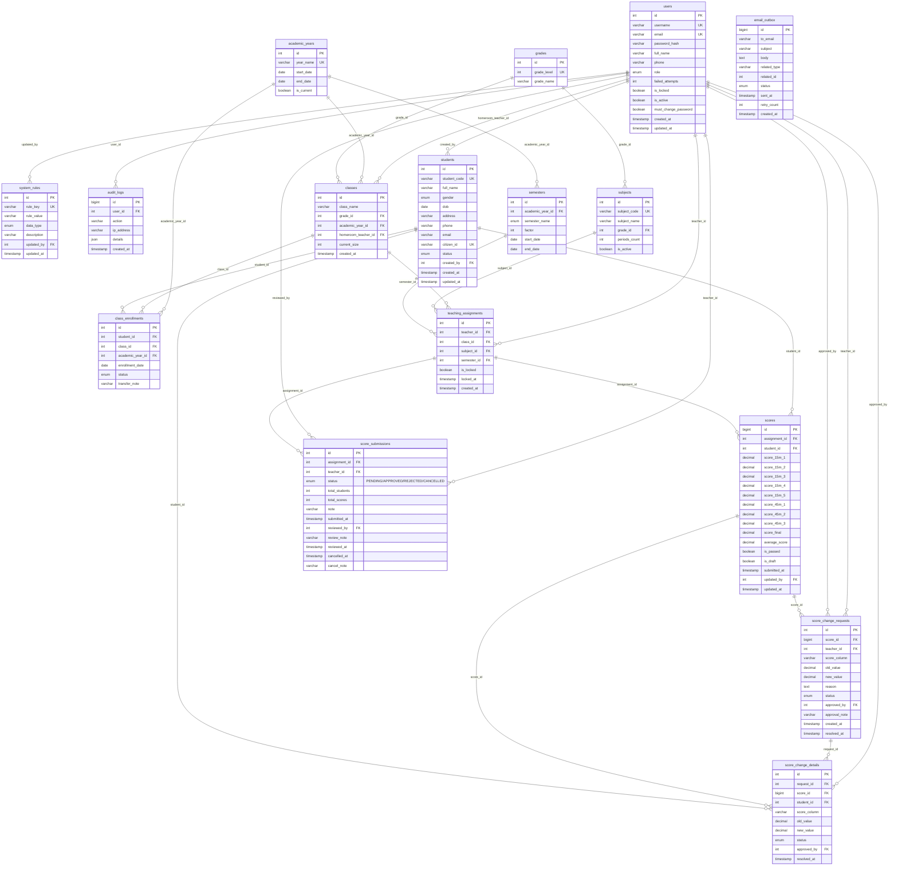

# Thiết kế Database — Hệ Thống Quản Lý Học Sinh / Sinh Viên

**Hệ quản trị cơ sở dữ liệu:** MySQL 8.x  
**Storage Engine:** InnoDB (hỗ trợ ACID transactions, khóa ngoại Foreign Key, Row-level Locking)  
**Bảng mã (Charset / Collation):** `utf8mb4` / `utf8mb4_unicode_ci`  
**ORM Framework:** SQLAlchemy (Python Flask)  
**Quy chuẩn thiết kế:** Chuẩn hóa dạng 3NF (Third Normal Form), toàn vẹn tham chiếu, chỉ mục B-Tree tối ưu truy vấn  

---

## Tổng hợp các bảng

| STT | Tên bảng | Phân hệ nghiệp vụ | Mô tả chức năng | Ánh xạ Use Case |
|:---:|----------|-------------------|-----------------|:---------------:|
| | **1. Core & Security** | | | |
| 1 | `users` | Xác thực & Quản trị | Tài khoản người dùng (`STAFF`, `TEACHER`, `ACADEMIC`) | SD01, SD02, SD17 |
| 2 | `system_rules` | Cấu hình quy chế | Bảng quy định động (tuổi min/max, sĩ số tối đa, điểm đạt) | SD03, SD05, SD21 |
| 3 | `audit_logs` | Quản trị hệ thống | Nhật ký kiểm toán thao tác hệ thống (Audit Trail) | SD15 |
| | **2. Học vụ & Tổ chức lớp** | | | |
| 4 | `academic_years` | Niên khóa | Danh mục các năm học (VD: 2026-2027) | Chung |
| 5 | `semesters` | Học kỳ | Danh mục học kỳ (HK1, HK2) và hệ số tính điểm cả năm | SD11, SD12, SD20 |
| 6 | `grades` | Khối lớp | Danh mục khối (Khối 10, Khối 11, Khối 12) | SD05, SD22 |
| 7 | `classes` | Lớp sinh hoạt | Danh sách lớp sinh hoạt, sĩ số hiện tại và GV chủ nhiệm | SD05, SD06 |
| 8 | `students` | Quản lý học sinh | Hồ sơ lý lịch học sinh tiếp nhận vào trường | SD03, SD07, SD08 |
| 9 | `class_enrollments` | Lịch sử phân lớp | Danh sách phân lớp và điều chuyển lớp của học sinh | SD04, SD05, SD06 |
| | **3. Môn học & Giảng dạy** | | | |
| 10 | `subjects` | Chương trình đào tạo | Danh mục môn học phân theo khối lớp | SD22 |
| 11 | `teaching_assignments` | Phân công chuyên môn | Phân công giáo viên dạy lớp theo môn & khóa bảng điểm | SD09, SD16, SD18 |
| | **4. Điểm số & Khảo thí** | | | |
| 12 | `scores` | Kết quả học tập | Điểm 15', 1 tiết, thi cuối kỳ và điểm trung bình môn (cờ `is_draft` phân biệt bảng tạm & bảng chính thức) | SD11, SD12, SD20 |
| 13 | `score_change_requests` | Quy trình phúc khảo | Đơn cha — 1 lần gửi yêu cầu sửa điểm của GV (đơn lẻ hoặc đơn lô) | SD25, SD19 |
| 14 | `score_change_details` | Quy trình phúc khảo | Đơn con — từng ô điểm được đề nghị sửa, Giáo vụ duyệt/từ chối độc lập từng ô | SD25, SD19 |
| 15 | `email_outbox` | Hạ tầng thông báo | Hàng đợi gửi mail (Outbox Pattern) — tách khỏi transaction nghiệp vụ | SD19, SD23, SD24 |
| 16 | `score_submissions` | Gửi duyệt bảng điểm | Bảng điểm tạm Giáo viên gửi Giáo vụ duyệt & chốt (có vòng đời `PENDING` → `APPROVED`/`REJECTED`/`CANCELLED`) | SD23, SD24 |

> **Ghi chú:** Bảng `attendances` (điểm danh chuyên cần) đã được **loại bỏ** khỏi thiết kế vì Yêu cầu 3 của đề bài chỉ quy định *nhập điểm & xuất điểm trung bình lớp* — xem `requirements.md` §4.1.

**Tổng cộng:** 16 bảng quan hệ chuẩn hóa trong MySQL (bảng `attendances` đã loại bỏ).

---

## Sơ đồ quan hệ (ERD tóm tắt)

```
── Phân hệ Người dùng & Phân quyền ──────────────────────────────────────────
users (1) ──< classes (N) [homeroom_teacher_id]
  -> 1 Giáo viên có thể chủ nhiệm nhiều lớp qua các năm học

users (1) ──< students (N) [created_by]
  -> 1 Nhân viên tiếp nhận nhiều hồ sơ học sinh

users (1) ──< teaching_assignments (N) [teacher_id]
  -> 1 Giáo viên được phân công giảng dạy nhiều lớp môn học

users (1) ──< score_change_requests (N) [teacher_id / approved_by]
  -> Giáo viên gửi yêu cầu sửa điểm; Giáo vụ duyệt đơn

users (1) ──< audit_logs (N) [user_id]
  -> Lưu vết lịch sử thao tác của từng người dùng

── Phân hệ Tổ chức Học vụ & Lớp học ─────────────────────────────────────────
academic_years (1) ──< semesters (N) [academic_year_id]
  -> 1 Năm học gồm 2 học kỳ chính (HK1, HK2)

academic_years (1) ──< classes (N) [academic_year_id]
  -> Lớp sinh hoạt mở theo từng niên khóa cụ thể

grades (1) ──< classes (N) [grade_id]
  -> 1 Khối (10, 11, 12) bao gồm nhiều lớp sinh hoạt (10A1, 10A2...)

grades (1) ──< subjects (N) [grade_id]
  -> Môn học được phân phối theo khối chương trình đào tạo

classes (1) ──< class_enrollments (N) [class_id]
  -> 1 Lớp chứa danh sách nhiều học sinh (sĩ số <= 40)

students (1) ──< class_enrollments (N) [student_id]
  -> 1 Học sinh có lịch sử phân lớp qua từng niên khóa

── Phân hệ Phân công & Khảo thí ─────────────────────────────────────────────
classes (1) ──< teaching_assignments (N) [class_id]
subjects (1) ──< teaching_assignments (N) [subject_id]
semesters (1) ──< teaching_assignments (N) [semester_id]
  -> Phân công 1 giáo viên phụ trách 1 môn học tại 1 lớp trong 1 học kỳ cụ thể

teaching_assignments (1) ──< scores (N) [assignment_id]
students (1) ──< scores (N) [student_id]
  -> Bảng điểm môn học của từng học sinh theo phân công giảng dạy

scores (1) ──< score_change_requests (N) [score_id]
  -> Một dòng điểm có thể có các yêu cầu xin điều chỉnh khi bảng điểm bị khóa

score_change_requests (1) ──< score_change_details (N) [request_id]
users (1) ──< score_change_details (N) [approved_by]
  -> 1 đơn sửa điểm chứa N ô điểm được đề nghị sửa (đơn lẻ: N=1, đơn lô: N>1)

teaching_assignments (1) ──< score_submissions (N) [assignment_id]
users (1) ──< score_submissions (N) [teacher_id / reviewed_by]
  -> 1 Giáo viên gửi bảng điểm tạm của 1 lớp môn học lên Giáo vụ để duyệt & chốt
```

---

## 1. Bảng `users` (Tài khoản người dùng)

Lưu trữ thông tin xác thực, phân quyền (RBAC) và cơ chế bảo vệ brute-force khóa tài khoản sau 5 lần nhập sai liên tiếp.

| Tên cột | Kiểu dữ liệu | Ràng buộc | Diễn giải nghiệp vụ |
|---------|--------------|-----------|---------------------|
| `id` | INT AUTO_INCREMENT | PK | Khóa chính tự tăng |
| `username` | VARCHAR(50) | NOT NULL, UNIQUE | Tên đăng nhập hệ thống |
| `email` | VARCHAR(100) | NOT NULL, UNIQUE | Email liên lạc nhận thông báo từ Mail Server |
| `password_hash` | VARCHAR(255) | NOT NULL | Mật khẩu băm an toàn bằng BCrypt (với Salt) |
| `full_name` | VARCHAR(100) | NOT NULL | Họ và tên cán bộ / giáo viên |
| `phone` | VARCHAR(15) | NULLABLE | Số điện thoại liên lạc |
| `role` | ENUM('STAFF', 'TEACHER', 'ACADEMIC') | NOT NULL | Vai trò người dùng (Nhân viên, GV, Giáo vụ) |
| `failed_attempts` | INT | NOT NULL, DEFAULT 0 | Số lần nhập sai mật khẩu liên tiếp |
| `is_locked` | BOOLEAN | NOT NULL, DEFAULT FALSE | Trạng thái khóa tài khoản khi nhập sai $\ge 5$ lần |
| `is_active` | BOOLEAN | NOT NULL, DEFAULT TRUE | Trạng thái kích hoạt tài khoản |
`must_change_password` | BOOLEAN | NOT NULL, DEFAULT FALSE | SD17: tài khoản do admin cấp phải đổi MK ở lần đăng nhập đầu |
| `created_at` | TIMESTAMP | NOT NULL, DEFAULT CURRENT_TIMESTAMP | Thời điểm tạo tài khoản |
| `updated_at` | TIMESTAMP | NULLABLE, ON UPDATE CURRENT_TIMESTAMP | Thời điểm cập nhật cuối |

**Chỉ mục (Indexes):**
* `idx_users_username` (UNIQUE) — Phục vụ xác thực đăng nhập cực nhanh theo `username`.
* `idx_users_email` (UNIQUE) — Chống trùng lặp email và tra cứu khi gửi thư kích hoạt.
* `idx_users_role` — Phục vụ truy vấn danh sách giáo viên hoặc nhân viên.

---

## 2. Bảng `system_rules` (Quy định hệ thống động)

Quản lý toàn bộ tham số quy chế động của nhà trường, phục vụ việc thay đổi quy định (Yêu cầu 5) mà không sửa mã nguồn.

| Tên cột | Kiểu dữ liệu | Ràng buộc | Diễn giải nghiệp vụ |
|---------|--------------|-----------|---------------------|
| `id` | INT AUTO_INCREMENT | PK | Khóa chính |
| `rule_key` | VARCHAR(50) | NOT NULL, UNIQUE | Mã định danh quy định (VD: `MIN_AGE`, `MAX_CLASS_SIZE`) |
| `rule_value` | VARCHAR(100) | NOT NULL | Giá trị cấu hình của quy định (dạng chuỗi chuẩn hóa) |
| `data_type` | ENUM('INT', 'FLOAT', 'STRING', 'BOOLEAN') | NOT NULL, DEFAULT 'INT' | Kiểu dữ liệu thực tế để ép kiểu trong Service |
| `description` | VARCHAR(255) | NULLABLE | Giải thích chi tiết ý nghĩa của quy định |
| `updated_by` | INT | FK -> users.id, NULLABLE | Tài khoản Giáo vụ thực hiện cập nhật quy định cuối |
| `updated_at` | TIMESTAMP | NOT NULL, DEFAULT CURRENT_TIMESTAMP ON UPDATE CURRENT_TIMESTAMP | Thời điểm cập nhật quy định |

**Chỉ mục (Indexes):**
* `idx_rules_key` (UNIQUE) — Tối ưu hóa truy vấn cache cấu hình quy định tại tầng Service.

---

## 3. Bảng `audit_logs` (Nhật ký hệ thống)

Lưu vết kiểm toán tất cả các thao tác nhạy cảm: sửa điểm, khóa/mở bảng điểm, thay đổi quy định, đăng nhập thất bại.

| Tên cột | Kiểu dữ liệu | Ràng buộc | Diễn giải nghiệp vụ |
|---------|--------------|-----------|---------------------|
| `id` | BIGINT AUTO_INCREMENT | PK | Khóa chính |
| `user_id` | INT | FK -> users.id, NULLABLE | Người thực hiện hành vi (NULL nếu là System) |
| `action` | VARCHAR(100) | NOT NULL | Tên hành động (VD: `LOGIN_FAILED`, `UPDATE_SCORE`, `CHANGE_RULE`) |
| `ip_address` | VARCHAR(45) | NULLABLE | Địa chỉ IPv4/IPv6 của máy trạm người dùng |
| `details` | JSON | NULLABLE | Chi tiết dữ liệu trước/sau khi thay đổi dạng JSON |
| `created_at` | TIMESTAMP | NOT NULL, DEFAULT CURRENT_TIMESTAMP | Thời điểm phát sinh sự kiện |

**Chỉ mục (Indexes):**
* `idx_logs_action_created` (`action`, `created_at`) — Phục vụ lọc nhật ký theo thời gian và nghiệp vụ.

---

## 4. Bảng `academic_years` (Năm học / Niên khóa)

Quản lý thông tin niên khóa phục vụ công tác tổ chức giảng dạy và lưu trữ lịch sử học bạ.

| Tên cột | Kiểu dữ liệu | Ràng buộc | Diễn giải nghiệp vụ |
|---------|--------------|-----------|---------------------|
| `id` | INT AUTO_INCREMENT | PK | Khóa chính |
| `year_name` | VARCHAR(20) | NOT NULL, UNIQUE | Tên niên khóa (VD: `2025-2026`, `2026-2027`) |
| `start_date` | DATE | NOT NULL | Ngày khai giảng / bắt đầu niên khóa |
| `end_date` | DATE | NOT NULL | Ngày bế giảng / kết thúc niên khóa |
| `is_current` | BOOLEAN | NOT NULL, DEFAULT FALSE | Đánh dấu niên khóa đang hoạt động hiện hành |

---

## 5. Bảng `semesters` (Học kỳ)

Quản lý học kỳ theo niên khóa và quy định hệ số tính điểm cả năm theo chuẩn quy chế.

| Tên cột | Kiểu dữ liệu | Ràng buộc | Diễn giải nghiệp vụ |
|---------|--------------|-----------|---------------------|
| `id` | INT AUTO_INCREMENT | PK | Khóa chính |
| `academic_year_id` | INT | FK -> academic_years.id, NOT NULL | Thuộc niên khóa nào |
| `semester_name` | ENUM('HK1', 'HK2') | NOT NULL | Tên học kỳ (Học kỳ 1 hoặc Học kỳ 2) |
| `factor` | INT | NOT NULL, DEFAULT 1 | Hệ số tính điểm cả năm (HK1 hệ số 1, HK2 hệ số 2) |
| `start_date` | DATE | NOT NULL | Ngày bắt đầu học kỳ |
| `end_date` | DATE | NOT NULL | Ngày kết thúc học kỳ |

**Ràng buộc & Chỉ mục:**
* `uq_semester_year` (UNIQUE: `academic_year_id`, `semester_name`) — Một năm học chỉ có 1 HK1 và 1 HK2.

---

## 6. Bảng `grades` (Khối lớp)

Quản lý 3 khối học chuẩn theo đề bài (Khối 10, Khối 11, Khối 12).

| Tên cột | Kiểu dữ liệu | Ràng buộc | Diễn giải nghiệp vụ |
|---------|--------------|-----------|---------------------|
| `id` | INT AUTO_INCREMENT | PK | Khóa chính |
| `grade_level` | INT | NOT NULL, UNIQUE | Cấp độ khối (10, 11, 12) |
| `grade_name` | VARCHAR(20) | NOT NULL | Tên khối hiển thị (Khối 10, Khối 11, Khối 12) |

---

## 7. Bảng `classes` (Lớp sinh hoạt)

Lưu trữ thông tin các lớp sinh hoạt của trường theo từng niên khóa, quản lý sĩ số hiện tại không vượt quá quy định ($\le 40$).

| Tên cột | Kiểu dữ liệu | Ràng buộc | Diễn giải nghiệp vụ |
|---------|--------------|-----------|---------------------|
| `id` | INT AUTO_INCREMENT | PK | Khóa chính |
| `class_name` | VARCHAR(50) | NOT NULL | Tên lớp sinh hoạt (VD: `10A1`, `10A2`, `11B1`) |
| `grade_id` | INT | FK -> grades.id, NOT NULL | Lớp thuộc khối nào (Khối 10, 11 hoặc 12) |
| `academic_year_id` | INT | FK -> academic_years.id, NOT NULL | Thuộc niên khóa nào |
| `homeroom_teacher_id` | INT | FK -> users.id, NULLABLE | Giáo viên chủ nhiệm lớp |
| `current_size` | INT | NOT NULL, DEFAULT 0 | Sĩ số suy diễn (cache của `COUNT(class_enrollments DANG_HOC)`; ràng buộc $\le 40$. Mọi enroll/transfer phải `SELECT ... FOR UPDATE` + cập nhật trong 1 transaction — xem SD05/SD06) |
| `created_at` | TIMESTAMP | NOT NULL, DEFAULT CURRENT_TIMESTAMP | Thời điểm tạo lớp |

**Ràng buộc & Chỉ mục:**
* `uq_class_name_year` (UNIQUE: `class_name`, `academic_year_id`) — Tên lớp là duy nhất trong một năm học.
* `idx_classes_grade_year` (`grade_id`, `academic_year_id`) — Tối ưu lọc danh sách lớp theo khối.

---

## 8. Bảng `students` (Hồ sơ học sinh - Yêu cầu 1)

Lưu trữ thông tin lý lịch cá nhân của học sinh khi tiếp nhận; kiểm tra ràng buộc độ tuổi từ 15 đến 20 tuổi ($15 \le \text{Tuổi} \le 20$).

| Tên cột | Kiểu dữ liệu | Ràng buộc | Diễn giải nghiệp vụ |
|---------|--------------|-----------|---------------------|
| `id` | INT AUTO_INCREMENT | PK | Khóa chính |
| `student_code` | VARCHAR(20) | NOT NULL, UNIQUE | Mã số học sinh duy nhất trong toàn trường |
| `full_name` | VARCHAR(100) | NOT NULL | Họ và tên học sinh |
| `gender` | ENUM('NAM', 'NU') | NOT NULL | Giới tính học sinh |
| `dob` | DATE | NOT NULL | Ngày tháng năm sinh (tính tuổi tiếp nhận) |
| `address` | VARCHAR(255) | NOT NULL | Địa chỉ cư trú của học sinh |
| `phone` | VARCHAR(15) | NULLABLE | Số điện thoại liên lạc |
| `email` | VARCHAR(100) | NULLABLE | Địa chỉ email học sinh/phụ huynh |
| `citizen_id` | VARCHAR(20) | NULLABLE, UNIQUE | CCCD/định danh cá nhân (dùng cho SD07 kiểm tra trùng) |
| `status` | ENUM('DANG_HOC', 'THOI_HOC', 'CHUYEN_TRUONG', 'TOT_NGHIEP') | NOT NULL, DEFAULT 'DANG_HOC' | Tình trạng học tập của học sinh |
| `created_by` | INT | FK -> users.id, NOT NULL | Nhân viên hồ sơ thực hiện tiếp nhận |
| `created_at` | TIMESTAMP | NOT NULL, DEFAULT CURRENT_TIMESTAMP | Thời điểm lập hồ sơ tiếp nhận |
| `updated_at` | TIMESTAMP | NULLABLE, ON UPDATE CURRENT_TIMESTAMP | Thời điểm cập nhật hồ sơ |

**Chỉ mục (Indexes):**
* `idx_students_code` (UNIQUE) — Tra cứu hồ sơ nhanh theo mã số định danh.
* `idx_students_name` (`full_name`) — Phục vụ chức năng tra cứu tìm kiếm theo tên học sinh.
* `idx_students_dob` (`dob`) — Phục vụ lọc thống kê độ tuổi học sinh toàn trường.
* `idx_students_citizen` (UNIQUE) — Kiểm tra trùng CCCD tại SD07.

---

## 9. Bảng `class_enrollments` (Lịch sử phân bổ & Điều chuyển lớp - Yêu cầu 2)

Quản lý mối quan hệ học sinh - lớp học qua từng năm học, hỗ trợ quy trình chuyển lớp mà không làm mất lịch sử học bạ.

| Tên cột | Kiểu dữ liệu | Ràng buộc | Diễn giải nghiệp vụ |
|---------|--------------|-----------|---------------------|
| `id` | INT AUTO_INCREMENT | PK | Khóa chính |
| `student_id` | INT | FK -> students.id, NOT NULL | Học sinh được xếp lớp |
| `class_id` | INT | FK -> classes.id, NOT NULL | Lớp sinh hoạt được phân vào |
| `academic_year_id` | INT | FK -> academic_years.id, NOT NULL | Niên khóa phân lớp |
| `enrollment_date` | DATE | NOT NULL | Ngày xếp lớp hoặc ngày chuyển đến |
| `status` | ENUM('DANG_HOC', 'DA_CHUYEN_LOP') | NOT NULL, DEFAULT 'DANG_HOC' | Trạng thái hiện diện trong lớp |
| `transfer_note` | VARCHAR(255) | NULLABLE | Ghi chú lý do điều chuyển lớp (nếu có) |

**Ràng buộc & Chỉ mục:**
* `idx_student_year_status` (`student_id`, `academic_year_id`, `status`) — Tra cứu lớp hiện tại + lịch sử chuyển lớp của học sinh. **Không đặt UNIQUE ở DB** (MySQL không có partial index; lịch sử cần nhiều dòng `DA_CHUYEN_LOP`). Quy tắc “1 `DANG_HOC`/năm” enforce ở tầng Service bằng `SELECT ... FOR UPDATE` trong transaction (SD06).
* `idx_enrollment_class` (`class_id`, `status`) — Tối ưu đếm sĩ số lớp và trích xuất danh sách học sinh.

---

## 10. Bảng `subjects` (Danh mục môn học - Yêu cầu 5)

Quản lý môn học được giảng dạy cho từng khối lớp theo quy chế nhà trường.

| Tên cột | Kiểu dữ liệu | Ràng buộc | Diễn giải nghiệp vụ |
|---------|--------------|-----------|---------------------|
| `id` | INT AUTO_INCREMENT | PK | Khóa chính |
| `subject_code` | VARCHAR(20) | NOT NULL, UNIQUE | Mã định danh môn học (VD: `TOAN10`, `VAN11`) |
| `subject_name` | VARCHAR(100) | NOT NULL | Tên môn học (Toán học, Ngữ văn, Vật lý...) |
| `grade_id` | INT | FK -> grades.id, NOT NULL | Môn học thuộc chương trình khối lớp nào |
| `periods_count` | INT | NOT NULL, DEFAULT 45 | Tổng số tiết định mức trong học kỳ |
| `is_active` | BOOLEAN | NOT NULL, DEFAULT TRUE | Trạng thái môn học có còn giảng dạy không |

**Chỉ mục (Indexes):**
* `idx_subjects_grade` (`grade_id`, `is_active`) — Phục vụ trích xuất danh mục môn học theo từng khối.

---

## 11. Bảng `teaching_assignments` (Phân công giảng dạy & Khóa điểm)

Gán giáo viên phụ trách bộ môn cho lớp học; quản lý trạng thái Khóa/Mở bảng điểm để ngăn chặn sửa điểm trái phép.

| Tên cột | Kiểu dữ liệu | Ràng buộc | Diễn giải nghiệp vụ |
|---------|--------------|-----------|---------------------|
| `id` | INT AUTO_INCREMENT | PK | Khóa chính |
| `teacher_id` | INT | FK -> users.id, NOT NULL | Giáo viên được phân công giảng dạy |
| `class_id` | INT | FK -> classes.id, NOT NULL | Lớp học được phân công |
| `subject_id` | INT | FK -> subjects.id, NOT NULL | Môn học phân công |
| `semester_id` | INT | FK -> semesters.id, NOT NULL | Học kỳ áp dụng phân công |
| `is_locked` | BOOLEAN | NOT NULL, DEFAULT FALSE | **Cờ đã chốt bảng điểm** (TRUE: điểm đã được Giáo vụ duyệt & chốt, GV không sửa trực tiếp nữa) |
| `locked_at` | TIMESTAMP | NULLABLE | Thời điểm bảng điểm được chốt (Giáo vụ duyệt) |
| `created_at` | TIMESTAMP | NOT NULL, DEFAULT CURRENT_TIMESTAMP | Thời điểm lập phân công |

**Ràng buộc & Chỉ mục:**
* `uq_teacher_class_subject_sem` (UNIQUE: `class_id`, `subject_id`, `semester_id`) — Mỗi lớp môn học trong một học kỳ chỉ do duy nhất 1 giáo viên phụ trách.
* `idx_assignment_teacher` (`teacher_id`, `semester_id`) — Lấy nhanh danh sách lớp dạy của một giáo viên.

> **Thay đổi ý nghĩa của `is_locked` (luồng "Gửi duyệt bảng điểm"):**
> * `is_locked = FALSE` → Bảng điểm **đang mở**: Giáo viên nhập điểm vào **bảng điểm tạm** (`scores.is_draft = TRUE`) và sửa thoải mái, không cần xin quyền.
> * `is_locked = TRUE` → Bảng điểm **đã chốt**: điểm chính thức (`scores.is_draft = FALSE`). Giáo viên **không** sửa trực tiếp nữa → phải gửi đơn phúc khảo qua `POST /score-requests` (bảng `score_change_requests`).

---

## 12. Bảng `scores` (Bảng điểm môn học - Yêu cầu 3 & 4)

Lưu trữ điểm thành phần theo biểu mẫu BẢNG ĐIỂM MÔN HỌC: 15 phút (1-5 cột), 1 tiết (1-3 cột), điểm thi cuối kỳ, tự động tính Điểm trung bình và đánh dấu trạng thái Đạt ($\text{ĐTB} \ge 5.0$).

> **🎯 Quy ước giá trị ô điểm — "NULL = chưa nhập, 0 = đã nhập" (đã chốt 12/11/2026):**
>
> | Trạng thái ô | Giá trị trong DB | Tính vào ĐTB | Ý nghĩa nghiệp vụ |
> |---|---|---|---|
> | **Chưa nhập** | `NULL` (ô để trống trên form) | ❌ Không tính | Giáo viên chưa chấm ô này — **lỗi GV**, chặn bước "Gửi duyệt" |
> | **Vắng** | `0.00` | ✅ Có tính | Học sinh vắng kiểm tra → quy về **0 điểm** |
> | **Thi = 0 điểm** | `0.00` | ✅ Có tính | Học sinh có dự thi nhưng làm sai hết → **0 điểm** |
> | **Đã chấm** | `0.00` – `10.00` | ✅ Có tính | Điểm thực tế |
>
> * **Không dùng giá trị đặc biệt** (ví dụ `-1`) và **không cần cờ `is_absent`** → đơn giản, dễ giải thích khi bảo vệ đồ án.
> * **Hệ quả:** ô `NULL` được **loại khỏi cả tử số lẫn mẫu số** của công thức ĐTB; ô có giá trị `0.00` **vẫn được tính** → học sinh vắng **bị trừ điểm đúng như thực tế** (Giáo vụ nhìn thấy điều này khi duyệt).
> * **Công thức DUY NHẤT:** tử số = tổng điểm các ô **có giá trị** (× 1 / 2 / 3); mẫu số = **số ô có giá trị** tương ứng (× 1 / 2 / 3). **KHÔNG** dùng "số cột theo quy chế" làm mẫu số — nếu dùng, khi GV mới chấm dở (VD 2/5 cột) ĐTB sẽ nhảy giữa các lần lưu.
> * **Partial update khi GV lưu:** ô gửi lên với `null` → **giữ nguyên giá trị trong DB** (không ghi `NULL`, không xoá điểm đã chấm). Ô chưa từng có giá trị → vẫn `NULL` → bị chặn ở bước "Gửi duyệt" (`422 INCOMPLETE_SCORES`). Xoá điểm đã chấm có chủ đích → `PUT /scores/{id}` với `clear: true` (ghi `audit_logs`).
> * **Giao diện:** mỗi ô có checkbox **"Vắng"** → tự điền `0` (cách nhập nhanh cho GV, **không** làm thay đổi giá trị).
> * **Ràng buộc chặt:** ô `NULL` được phép ở bước **"Lưu"** (`POST /scores/batch`) nhưng **không được phép** ở bước **"Gửi duyệt"** (`POST /score-submissions`) → mã lỗi `422 INCOMPLETE_SCORES`.

| Tên cột | Kiểu dữ liệu | Ràng buộc | Diễn giải nghiệp vụ |
|---------|--------------|-----------|---------------------|
| `id` | BIGINT AUTO_INCREMENT | PK | Khóa chính |
| `assignment_id` | INT | FK -> teaching_assignments.id, NOT NULL | Liên kết tới lớp môn học và học kỳ |
| `student_id` | INT | FK -> students.id, NOT NULL | Học sinh nhận điểm |
| `score_15m_1` | DECIMAL(4,2) | NULLABLE | Điểm kiểm tra 15 phút - Cột 1 ($0.0 \le \text{Điểm} \le 10.0$) |
| `score_15m_2` | DECIMAL(4,2) | NULLABLE | Điểm kiểm tra 15 phút - Cột 2 |
| `score_15m_3` | DECIMAL(4,2) | NULLABLE | Điểm kiểm tra 15 phút - Cột 3 |
| `score_15m_4` | DECIMAL(4,2) | NULLABLE | Điểm kiểm tra 15 phút - Cột 4 |
| `score_15m_5` | DECIMAL(4,2) | NULLABLE | Điểm kiểm tra 15 phút - Cột 5 |
| `score_45m_1` | DECIMAL(4,2) | NULLABLE | Điểm kiểm tra 1 tiết - Cột 1 |
| `score_45m_2` | DECIMAL(4,2) | NULLABLE | Điểm kiểm tra 1 tiết - Cột 2 |
| `score_45m_3` | DECIMAL(4,2) | NULLABLE | Điểm kiểm tra 1 tiết - Cột 3 |
| `score_final` | DECIMAL(4,2) | NULLABLE | Điểm thi cuối kỳ môn học |
| `average_score`| DECIMAL(4,2) | NULLABLE | Điểm trung bình môn học kỳ (hệ thống tự động tính — kể cả khi lưu bản nháp). Ô `NULL` bị loại khỏi cả tử số & mẫu số; ô `0.00` vẫn được tính. `NULL` khi học sinh **chưa có ô điểm nào** |
| `is_passed` | BOOLEAN | NULLABLE | Trạng thái Đạt ($\text{average\_score} \ge 5.0$ theo quy định). `NULL` khi chưa có điểm nào để tính ĐTB |
| `is_draft` | BOOLEAN | NOT NULL, DEFAULT TRUE | **Cờ bảng điểm tạm** (TRUE: GV đang soạn, chưa duyệt; FALSE: đã được Giáo vụ duyệt & chốt — đây mới là điểm chính thức) |
| `submitted_at` | TIMESTAMP | NULLABLE | Thời điểm GV gửi bảng điểm tạm để Giáo vụ duyệt |
| `updated_by` | INT | FK -> users.id, NULLABLE | Giáo viên cập nhật điểm lần cuối |
| `updated_at` | TIMESTAMP | NOT NULL, DEFAULT CURRENT_TIMESTAMP ON UPDATE CURRENT_TIMESTAMP | Thời điểm tính toán và lưu điểm |

> **Vai trò của cột `is_draft` (luồng "Gửi duyệt bảng điểm"):**
> * Mọi lần Giáo viên bấm **"Lưu"** ở BẢNG ĐIỂM MÔN HỌC → ghi vào chính bảng `scores` với `is_draft = TRUE` (**ghi đè** bản nháp cũ, không tính lại ĐTB cũ, không ghi `audit_logs` chính thức). Hệ thống **vẫn tính `average_score`** ngay để Giáo viên tự kiểm tra.
> * Bấm **"Gửi duyệt"** → tạo bản ghi `score_submissions` (trạng thái `PENDING`) + đóng dấu `scores.submitted_at`.
> * Giáo vụ **duyệt** → chuyển toàn bộ `scores` của assignment đó từ `is_draft = TRUE` → `FALSE` **và** đặt `teaching_assignments.is_locked = TRUE` (bảng điểm chính thức).
> * **Mọi truy vấn báo cáo / xuất file / xem điểm chính thức đều phải lọc `WHERE is_draft = FALSE`** → điểm chưa duyệt không bao giờ lộ ra ngoài.

**Công thức nghiệp vụ tính Điểm Trung Bình Môn (`average_score`):**
$$\text{ĐTB} = \frac{\sum \text{Điểm 15'} \times 1 + \sum \text{Điểm 1 tiết} \times 2 + \text{Điểm thi} \times 3}{\text{Số cột 15'} + \text{Số cột 1 tiết} \times 2 + 3}$$

> **⚠️ Cách hiểu đúng (theo quy ước "NULL = chưa nhập, 0 = đã nhập"):**
> * Mỗi từ số "$\sum$ Điểm 15'" và "Số cột 15'" chỉ tính trên **các ô CÓ GIÁ TRỊ** (tức `NOT NULL`).
> * Ô `NULL` (chưa nhập) bị loại khỏi **cả tử số lẫn mẫu số** → không ảnh hưởng ĐTB.
> * Ô `0.00` (vắng / thi 0 điểm) **VẪN ĐƯỢC TÍNH** → học sinh vắng bị trừ điểm đúng như thực tế.
> * Trường hợp học sinh **chưa có ô điểm nào** (tất cả `NULL`) → `average_score = NULL`, `is_passed = NULL` → không tính vào tỷ lệ đạt trong báo cáo.
>
> **Ví dụ — HS vắng 1 buổi kiểm tra 15' số 3 (nhập `0`):**
> ```
> Điểm 15'   = 8.0, 8.0, 0.0        ← cả 3 đều có giá trị → tử số 16, mẫu số 3
> Điểm 1 tiết = 7.0                 ← tử số 14, mẫu số 2
> Điểm thi    = 8.0                  ← tử số 24, mẫu số 3
> ĐTB = (16 + 14 + 24) / (3 + 2 + 3) = 54 / 8 = 6.75
> ```

**Ràng buộc & Chỉ mục:**
* `uq_score_student_assignment` (UNIQUE: `assignment_id`, `student_id`) — Mỗi học sinh chỉ có một dòng điểm cho một phân công môn học.
* `idx_scores_assignment` (`assignment_id`) — Tối ưu trích xuất toàn bộ bảng điểm lớp để tính toán và xuất file.
* `idx_scores_passed` (`assignment_id`, `is_passed`) — **Tối ưu báo cáo thống kê Yêu cầu 4:** Đếm số lượng học sinh đạt và tính tỷ lệ $\%$ cho biểu đồ Chart.js trong vài mili-giây.
* `idx_scores_draft` (`assignment_id`, `is_draft`) — **Tối ưu luồng duyệt bảng điểm:** lấy nhanh điểm tạm (`is_draft = TRUE`) để giáo viên tiếp tục soạn, và điểm chính thức (`is_draft = FALSE`) cho báo cáo/xuất file.

---

## 13. Bảng `score_change_requests` (Yêu cầu chỉnh sửa điểm - Phúc khảo)

Quản lý luồng mở rộng `<<extend>> Gửi yêu cầu chỉnh điểm` khi bảng điểm đã bị khóa bởi Giáo vụ.

> **Thiết kế 2 tầng (đơn cha — đơn con):**
> * Bảng này là **đơn cha** — đại diện cho **1 lần gửi yêu cầu sửa điểm** của Giáo viên.
> * Mỗi **ô điểm** được đề nghị sửa nằm ở bảng con `score_change_details` (§14).
> * Nhờ vậy hỗ trợ **đồng thời** hai mức: **đơn lẻ** (1 ô điểm) và **đơn lô** (nhiều ô điểm của nhiều học sinh) — dùng chung **một luồng nghiệp vụ**, chỉ khác ở số bản ghi con.
> * Đơn lẻ: 1 `score_change_requests` + 1 `score_change_details` — các cột `score_id` / `score_column` / `old_value` / `new_value` ở bảng cha được giữ lại để tương thích ngược & truy vấn nhanh.

| Tên cột | Kiểu dữ liệu | Ràng buộc | Diễn giải nghiệp vụ |
|---------|--------------|-----------|---------------------|
| `id` | INT AUTO_INCREMENT | PK | Khóa chính |
| `score_id` | BIGINT | FK -> scores.id, NOT NULL | Bản ghi điểm số cần điều chỉnh |
| `teacher_id` | INT | FK -> users.id, NOT NULL | Giáo viên bộ môn tạo đơn yêu cầu sửa |
| `score_column` | VARCHAR(30) | NOT NULL, CHECK IN (`score_15m_1`..`score_15m_5`, `score_45m_1`..`score_45m_3`, `score_final`) | Cột điểm cần sửa (whitelist 9 cột của bảng `scores`) |
| `old_value` | DECIMAL(4,2) | NOT NULL | Giá trị điểm cũ tại thời điểm GV gửi đơn. **Luôn có giá trị** vì đơn phúc khảo chỉ tạo được khi bảng điểm đã **CHỐT** (`is_locked = true`) ⇒ mọi ô đã `NOT NULL` (ràng buộc B1 chặn lúc gửi duyệt) |
| `new_value` | DECIMAL(4,2) | NOT NULL | Giá trị điểm số mới đề xuất thay đổi |
| `reason` | TEXT | NOT NULL | Lý do điều chỉnh điểm (chấm sót, gõ nhầm, phúc khảo...) |
| `status` | ENUM('PENDING', 'APPROVED', 'REJECTED', 'PARTIALLY_APPROVED') | NOT NULL, DEFAULT 'PENDING' | Trạng thái tổng hợp của đơn. `PARTIALLY_APPROVED` = có ô được duyệt, có ô bị từ chối (chỉ xảy ra với đơn lô) |
| `is_batch` | BOOLEAN | NOT NULL, DEFAULT FALSE | `TRUE` = đơn lô (nhiều ô điểm), `FALSE` = đơn lẻ (1 ô điểm) |
| `total_changes` | INT | NOT NULL, DEFAULT 1 | Tổng số ô điểm được đề nghị sửa trong đơn |
| `attachment_path` | VARCHAR(255) | NULLABLE | Đường dẫn file đính kèm (ảnh chấm lại bài / biên bản phúc khảo) — **luôn tùy chọn** |
| `attachment_type` | VARCHAR(20) | NULLABLE, CHECK IN (`IMAGE', 'PDF') | Loại file đính kèm |
| `attachment_name` | VARCHAR(255) | NULLABLE | Tên file gốc khi tải lên (hiển thị cho Giáo vụ) |
| `approved_by` | INT | FK -> users.id, NULLABLE | Tài khoản Giáo vụ xử lý đơn |
| `approval_note`| VARCHAR(255) | NULLABLE | Phản hồi hoặc lý do từ chối của Giáo vụ |
| `created_at` | TIMESTAMP | NOT NULL, DEFAULT CURRENT_TIMESTAMP | Thời điểm giáo viên nộp đơn yêu cầu sửa |
| `resolved_at` | TIMESTAMP | NULLABLE | Thời điểm Giáo vụ phê duyệt hoặc từ chối |

**Chỉ mục (Indexes):**
* `idx_requests_status` (`status`, `created_at`) — Phục vụ Giáo vụ lọc danh sách đơn đang chờ duyệt (`PENDING`).

---

## 14. Bảng `score_change_details` (Chi tiết từng ô điểm đề nghị sửa)

Bảng con của `score_change_requests` (§13). Mỗi bản ghi đại diện cho **1 ô điểm** được Giáo viên đề nghị sửa trong 1 đơn. Nhờ tách riêng trạng thái ở tầng ô, Giáo vụ có thể **duyệt từng ô** — trong 1 đơn lô gồm nhiều ô, chỉ những ô thực sự có căn cứ mới được áp dụng.

| Tên cột | Kiểu dữ liệu | Ràng buộc | Diễn giải nghiệp vụ |
|---------|--------------|-----------|---------------------|
| `id` | INT AUTO_INCREMENT | PK | Khóa chính |
| `request_id` | INT | FK -> score_change_requests.id, NOT NULL | Đơn cha chứa ô điểm này |
| `score_id` | BIGINT | FK -> scores.id, NOT NULL | Dòng điểm của học sinh cần điều chỉnh |
| `student_id` | INT | FK -> students.id, NOT NULL | Học sinh (denormalize để hiển thị nhanh, tránh join khi duyệt) |
| `score_column` | VARCHAR(30) | NOT NULL, CHECK IN (`score_15m_1`..`score_15m_5`, `score_45m_1`..`score_45m_3`, `score_final`) | Cột điểm cần sửa (whitelist 9 cột của bảng `scores`) |
| `old_value` | DECIMAL(4,2) | NOT NULL | Giá trị điểm cũ tại thời điểm GV gửi đơn — **luôn có giá trị** (bảng điểm đã CHỐT ⇒ mọi ô đã `NOT NULL`) |
| `new_value` | DECIMAL(4,2) | NOT NULL | Giá trị điểm số mới GV đề xuất |
| `status` | ENUM('PENDING', 'APPROVED', 'REJECTED') | NOT NULL, DEFAULT 'PENDING' | **Trạng thái riêng của từng ô** — Giáo vụ duyệt/từ chối độc lập từng ô |
| `approved_by` | INT | FK -> users.id, NULLABLE | Giáo vụ đã xử lý ô này |
| `resolved_at` | TIMESTAMP | NULLABLE | Thời điểm xử lý ô này |

**Chỉ mục (Indexes):**
* `idx_details_request` (`request_id`) — Lấy nhanh toàn bộ ô điểm của 1 đơn để Giáo vụ duyệt.
* `idx_details_status` (`status`) — Thống kê các ô đang chờ xử lý.
* `uq_details_request_score_col` (UNIQUE: `request_id`, `score_id`, `score_column`) — Chống trùng lặp: 1 đơn không được đề nghị sửa 2 lần cùng 1 ô điểm.

**Quy tắc nghiệp vụ:**
* **Trạng thái thật nằm ở bảng con** (`score_change_details.status`) — `score_change_requests.status` chỉ là **tóm tắt** để lọc nhanh. Khi code cần biết "ô nào được áp dụng" → **luôn query bảng con**, đừng đọc cờ đơn cha.
* `score_change_requests.status` được cập nhật tự động: tất cả ô `APPROVED` → `APPROVED`; tất cả `REJECTED` → `REJECTED`; hỗn hợp → `PARTIALLY_APPROVED`.
* Khi Giáo vụ **DUYỆT** một ô: `UPDATE scores` với giá trị `new_value`, **giữ nguyên `scores.is_draft = FALSE`** (điểm chính thức) và tính lại `average_score` & `is_passed` cho học sinh tương ứng. Toàn bộ các ô được duyệt trong 1 lần xử lý phải nằm trong **cùng một transaction (ACID)**.

---

## 15. Bảng `email_outbox` (Hàng đợi gửi mail thông báo)

Tách việc gửi mail khỏi transaction nghiệp vụ để bảo đảm **tính nhất quán dữ liệu**: nếu gửi mail trong transaction mà SMTP lỗi → có thể xảy ra tình huống Giáo viên đã nhận mail "đã duyệt" nhưng DB bị rollback. Giải pháp: ghi mail vào outbox **cùng transaction**, sau COMMIT worker mới gửi.

| Tên cột | Kiểu dữ liệu | Ràng buộc | Diễn giải nghiệp vụ |
|---------|--------------|-----------|---------------------|
| `id` | BIGINT AUTO_INCREMENT | PK | Khóa chính |
| `to_email` | VARCHAR(255) | NOT NULL | Địa chỉ nhận (email của Giáo viên hoặc Giáo vụ) |
| `subject` | VARCHAR(255) | NOT NULL | Tiêu đề email |
| `body` | TEXT | NOT NULL | Nội dung email (render từ template) |
| `related_type` | VARCHAR(50) | NULLABLE | Loại đối tượng liên quan (`SCORE_REQUEST`, `SCORE_SUBMISSION`) |
| `related_id` | INT | NULLABLE | ID của đối tượng liên quan (truy vết nhanh) |
| `status` | ENUM('PENDING', 'SENT', 'FAILED') | NOT NULL, DEFAULT 'PENDING' | Trạng thái gửi |
| `sent_at` | TIMESTAMP | NULLABLE | Thời điểm gửi thành công |
| `retry_count` | INT | NOT NULL, DEFAULT 0 | Số lần thử gửi lại |
| `created_at` | TIMESTAMP | NOT NULL, DEFAULT CURRENT_TIMESTAMP | Thời điểm enqueue |

**Chỉ mục (Indexes):**
* `idx_outbox_status` (`status`, `created_at`) — Worker lấy các mail đang chờ gửi (`PENDING`).

> **Quy tắc nghiệp vụ — phải giữ `is_draft = FALSE` khi duyệt phúc khảo:**
> * Khi Giáo vụ **DUYỆT** một đơn `score_change_requests`: điểm mới được ghi thẳng vào **điểm chính thức** → **giữ nguyên `scores.is_draft = FALSE`** (tuyệt đối không ghi vào bảng điểm tạm, nếu không điểm đã chốt sẽ bị "hạ" về bản nháp và biến mất khỏi báo cáo).
> * Đồng thời **không** đụng tới `teaching_assignments.is_locked` — bảng điểm vẫn ở trạng thái **ĐÃ CHỐT** sau khi phúc khảo được duyệt.
> * Việc tính lại `average_score` & `is_passed` diễn ra trong **cùng một transaction** (ACID) với `UPDATE scores`.
> * Khi Giáo vụ **TỪ CHỐI**: không thay đổi bất kỳ dữ liệu điểm nào.

---

## 16. Bảng `score_submissions` (Gửi duyệt bảng điểm)

Quản lý luồng Giáo viên **gửi bảng điểm tạm** lên Giáo vụ để duyệt & chốt. Khác với `score_change_requests` (đơn sửa **một ô điểm** sau khi đã chốt), bảng này quản lý việc duyệt **toàn bộ bảng điểm của một lớp môn học**.

| Tên cột | Kiểu dữ liệu | Ràng buộc | Diễn giải nghiệp vụ |
|---------|--------------|-----------|---------------------|
| `id` | INT AUTO_INCREMENT | PK | Khóa chính |
| `assignment_id` | INT | FK -> teaching_assignments.id, NOT NULL | Lớp môn học mà bảng điểm được gửi duyệt |
| `teacher_id` | INT | FK -> users.id, NOT NULL | Giáo viên gửi bảng điểm lên duyệt |
| `status` | ENUM('PENDING', 'APPROVED', 'REJECTED', 'CANCELLED') | NOT NULL, DEFAULT 'PENDING' | Trạng thái duyệt của bảng điểm. `CANCELLED` = **Giáo viên tự hủy** để sửa lại bảng điểm tạm |
| `total_students` | INT | NOT NULL | Số học sinh có dòng điểm trong bảng điểm được gửi |
| `total_scores` | INT | NOT NULL | Tổng số ô điểm đã nhập (để Giáo vụ đối chiếu độ đầy đủ) |
| `note` | VARCHAR(255) | NULLABLE | Ghi chú của Giáo viên kèm theo (VD: "Đã chấm xong 3 lớp 15'") |
| `submitted_at` | TIMESTAMP | NOT NULL, DEFAULT CURRENT_TIMESTAMP | Thời điểm Giáo viên gửi bảng điểm để duyệt |
| `reviewed_by` | INT | FK -> users.id, NULLABLE | Tài khoản Giáo vụ xử lý |
| `review_note` | VARCHAR(255) | NULLABLE | Phản hồi / lý do từ chối của Giáo vụ |
| `reviewed_at` | TIMESTAMP | NULLABLE | Thời điểm Giáo vụ duyệt hoặc từ chối |
| `cancelled_at` | TIMESTAMP | NULLABLE | Thời điểm Giáo viên hủy đơn để sửa lại bảng điểm tạm |
| `cancel_note` | VARCHAR(255) | NULLABLE | Lý do Giáo viên hủy đơn (VD: "Phát hiện chấm nhầm cột điểm 15' số 3") |

**Chỉ mục (Indexes):**
* `idx_submissions_status` (`status`, `submitted_at`) — Phục vụ Giáo vụ lọc danh sách bảng điểm đang chờ duyệt (`PENDING`).
* `uq_submissions_assignment_pending` (UNIQUE **partial**: `assignment_id` WHERE `status = 'PENDING'`) — Mỗi lớp môn học chỉ có **nhiều nhất 1** bản ghi đang chờ duyệt tại một thời điểm, nhưng **vẫn giữ được lịch sử** các bản ghi `CANCELLED` / `REJECTED` cũ.
  > ⚠️ Nếu dùng UNIQUE thuần trên `assignment_id` thì lần gửi thứ 2 sẽ **không insert được** → phải dùng **partial unique index** (MySQL 8.0+ hỗ trợ) hoặc cột `pending_key` sinh tự động = `assignment_id` khi `PENDING` và `NULL` khi khác.

**Vòng đời trạng thái (đã chốt 12/11/2026):**
```
   (chưa gửi) ──GV bấm "Gửi duyệt"──> PENDING ──┬── Giáo vụ DUYỆT ──────> APPROVED  (điểm chính thức, khóa bảng điểm)
                                              │
                                              ├── Giáo vụ TỪ CHỐI ────> REJECTED  (giữ is_draft=TRUE, GV sửa rồi gửi lại)
                                              │
                                              └── GV bấm "Hủy" ───────> CANCELLED (giữ is_draft=TRUE, GV sửa rồi gửi lại)
```

**Quy tắc nghiệp vụ:**
* Khi Giáo vụ **DUYỆT**: `UPDATE scores SET is_draft = FALSE WHERE assignment_id = ?` **và** `UPDATE teaching_assignments SET is_locked = TRUE, locked_at = NOW() WHERE id = ?` — thực hiện trong **cùng một transaction** (ACID) để không bao giờ xảy ra trạng thái nửa vời.
* Khi Giáo vụ **TỪ CHỐI**: giữ nguyên `scores.is_draft = TRUE` và `teaching_assignments.is_locked = FALSE` → Giáo viên sửa tiếp rồi gửi lại. Bản ghi cũ giữ lại làm lịch sử (`status = REJECTED`).
* Khi Giáo viên **HỦY** (`PUT /score-submissions/{id}/cancel`): giữ nguyên `scores.is_draft = TRUE` và `teaching_assignments.is_locked = FALSE` → GV sửa bảng điểm tạm rồi gửi duyệt lại. Bản ghi cũ giữ lại làm lịch sử (`status = CANCELLED`).
* **Chỉ Giáo viên gửi đơn mới được sửa bảng điểm tạm.** Khi đang có đơn `PENDING` → `POST /scores/batch` & `PUT /scores/{id}` phải từ chối với **423 `SCORE_SUBMISSION_PENDING`** → GV phải **Hủy** đơn trước rồi mới sửa được.
* **Mỗi lớp môn học chỉ có 1 đơn "đang hiệu lực"** (`PENDING`) tại một thời điểm; các đơn `CANCELLED` / `REJECTED` là **lịch sử**, giữ nguyên để audit.
* Bảng điểm đã chốt (`is_locked = TRUE`) không được gửi duyệt lại — muốn sửa phải dùng `POST /score-requests` (bảng `score_change_requests`).

---

## Sơ đồ quan hệ thực thể ERD (Mermaid Diagram)



---

## Dữ liệu khởi tạo mặc định (Seed Data)

### 1. Bảng `system_rules` (Quy định mặc định)
```sql
INSERT INTO `system_rules` (`rule_key`, `rule_value`, `data_type`, `description`) VALUES
('MIN_AGE', '15', 'INT', 'Độ tuổi tối thiểu khi tiếp nhận học sinh vào trường (YC 1)'),
('MAX_AGE', '20', 'INT', 'Độ tuổi tối đa khi tiếp nhận học sinh vào trường (YC 1)'),
('MAX_CLASS_SIZE', '40', 'INT', 'Sĩ số tối đa trong một lớp học sinh hoạt (YC 2)'),
('MIN_COL_15M', '1', 'INT', 'Số cột điểm kiểm tra 15 phút tối thiểu của mỗi môn học (YC 3)'),
('MAX_COL_15M', '5', 'INT', 'Số cột điểm kiểm tra 15 phút tối đa của mỗi môn học (YC 3)'),
('MIN_COL_45M', '1', 'INT', 'Số cột điểm kiểm tra 1 tiết tối thiểu của mỗi môn học (YC 3)'),
('MAX_COL_45M', '3', 'INT', 'Số cột điểm kiểm tra 1 tiết tối đa của mỗi môn học (YC 3)'),
('NUM_COL_FINAL', '1', 'INT', 'Số cột điểm thi học kỳ bắt buộc (YC 3)'),
('PASSING_SCORE', '5.0', 'FLOAT', 'Điểm trung bình chuẩn để xếp loại Đạt môn học (YC 4)'),
('MAX_LOGIN_ATTEMPTS', '5', 'INT', 'Số lần nhập sai mật khẩu tối đa trước khi tự động khóa tài khoản');
```

### 2. Bảng `grades` (Khối lớp)
```sql
INSERT INTO `grades` (`grade_level`, `grade_name`) VALUES
(10, 'Khối 10'),
(11, 'Khối 11'),
(12, 'Khối 12');
```

### 3. Bảng `academic_years` & `semesters` (Năm học & Học kỳ)
```sql
INSERT INTO `academic_years` (`year_name`, `start_date`, `end_date`, `is_current`) VALUES
('2026-2027', '2026-09-05', '2027-05-31', TRUE);

-- Không hard-code id niên khóa: lấy id vừa insert theo year_name
INSERT INTO `semesters` (`academic_year_id`, `semester_name`, `factor`, `start_date`, `end_date`)
SELECT id, 'HK1', 1, '2026-09-05', '2027-01-15' FROM `academic_years` WHERE `year_name` = '2026-2027'
UNION ALL
SELECT id, 'HK2', 2, '2027-01-16', '2027-05-31' FROM `academic_years` WHERE `year_name` = '2026-2027';
```

### 4. Bảng `subjects` (Môn học mẫu phân theo khối)
```sql
-- Lấy grade_id theo grade_level, không hard-code id số
INSERT INTO `subjects` (`subject_code`, `subject_name`, `grade_id`, `periods_count`, `is_active`) VALUES
('TOAN10', 'Toán học 10', (SELECT id FROM `grades` WHERE `grade_level` = 10), 90, TRUE),
('VAN10', 'Ngữ văn 10', (SELECT id FROM `grades` WHERE `grade_level` = 10), 90, TRUE),
('ANH10', 'Tiếng Anh 10', (SELECT id FROM `grades` WHERE `grade_level` = 10), 75, TRUE),
('LY10', 'Vật lý 10', (SELECT id FROM `grades` WHERE `grade_level` = 10), 60, TRUE),
('HOA10', 'Hóa học 10', (SELECT id FROM `grades` WHERE `grade_level` = 10), 60, TRUE),
('SINH10', 'Sinh học 10', (SELECT id FROM `grades` WHERE `grade_level` = 10), 45, TRUE),
('SU10', 'Lịch sử 10', (SELECT id FROM `grades` WHERE `grade_level` = 10), 45, TRUE),
('DIA10', 'Địa lý 10', (SELECT id FROM `grades` WHERE `grade_level` = 10), 45, TRUE),
('GDCD10', 'Giáo dục công dân 10', (SELECT id FROM `grades` WHERE `grade_level` = 10), 30, TRUE);
```

### 5. Bảng `users` (Tài khoản quản trị mặc định)
```sql
-- Mật khẩu mặc định: 'Admin@123' (hash bcrypt cost 12 thật, đã verify OK)
INSERT INTO `users` (`username`, `email`, `password_hash`, `full_name`, `role`, `is_active`) VALUES
('admin', 'admin@truongthpt.edu.vn', '$2b$12$3ffVgU6qbnhbW01KFaM4VecsFKoa4jYaYnZWLgXbqyEAgNmlHkNd2', 'Quản trị viên Giáo vụ', 'ACADEMIC', TRUE),
('nhanvien01', 'nv01@truongthpt.edu.vn', '$2b$12$3ffVgU6qbnhbW01KFaM4VecsFKoa4jYaYnZWLgXbqyEAgNmlHkNd2', 'Nguyễn Thị Hồ Sơ', 'STAFF', TRUE),
('giaovien01', 'gv01@truongthpt.edu.vn', '$2b$12$3ffVgU6qbnhbW01KFaM4VecsFKoa4jYaYnZWLgXbqyEAgNmlHkNd2', 'Trần Văn Giảng Viên', 'TEACHER', TRUE);
```
### Bảng `password_otps` (OTP 6 số đổi/quên mật khẩu)
| Cột | Kiểu | Ràng buộc |
|---|---|---|
| id | INT PK AI | Khóa chính |
| user_id | INT FK → users.id | Chủ OTP |
| purpose | VARCHAR(20) | `FORGOT` (quên, chưa login) / `CHANGE` (đổi, đã login) |
| code | CHAR(6) | OTP 6 số, sinh bằng `secrets` |
| expires_at | DATETIME | Hết hạn sau `OTP_EXPIRE_MINUTES` (mặc định 5p) |
| attempts | INT | Số lần nhập sai, quá `OTP_MAX_ATTEMPTS` (5) thì hủy |
| used | BOOLEAN | 1 lần dùng; OTP cũ cùng purpose bị vô hiệu khi xin mã mới |

Rules mới trong `system_rules`: `OTP_EXPIRE_MINUTES=5`, `OTP_MAX_ATTEMPTS=5`.
